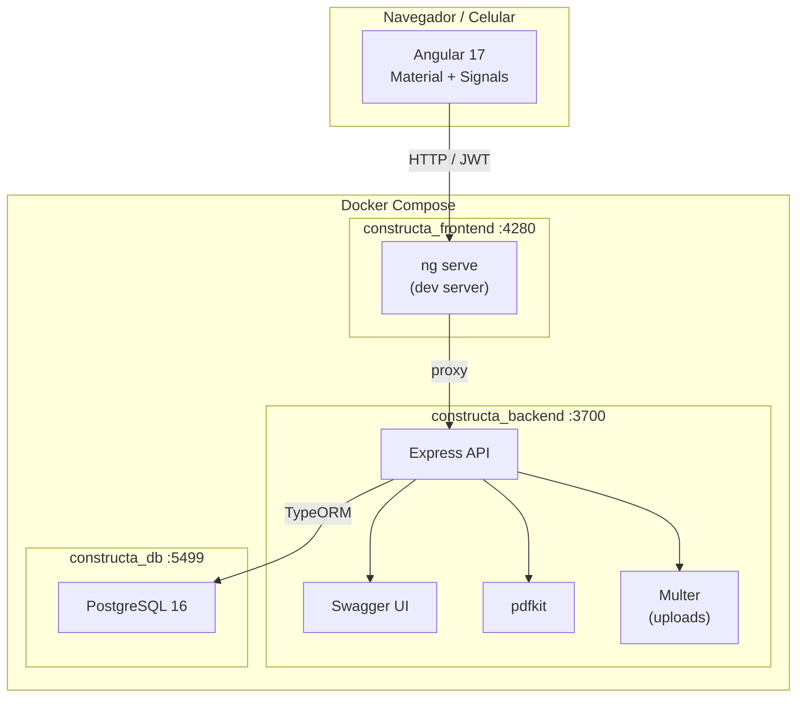
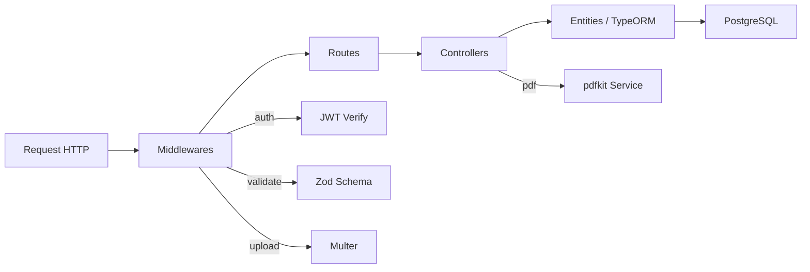
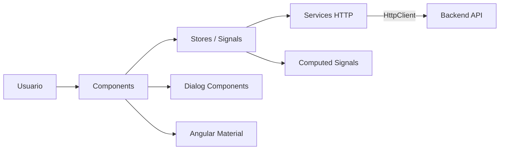
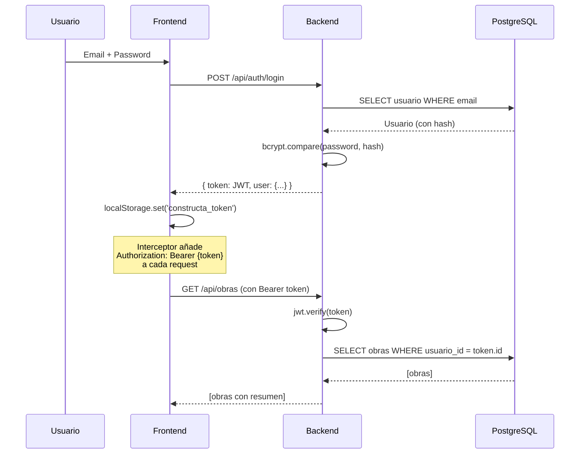
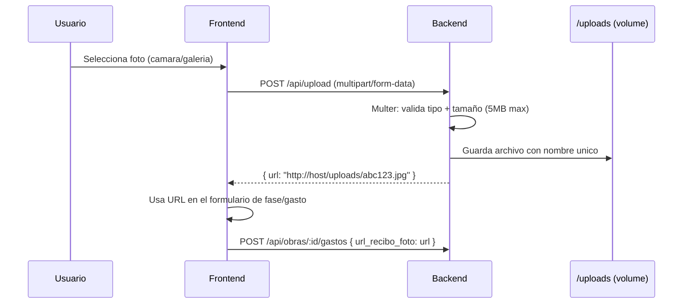
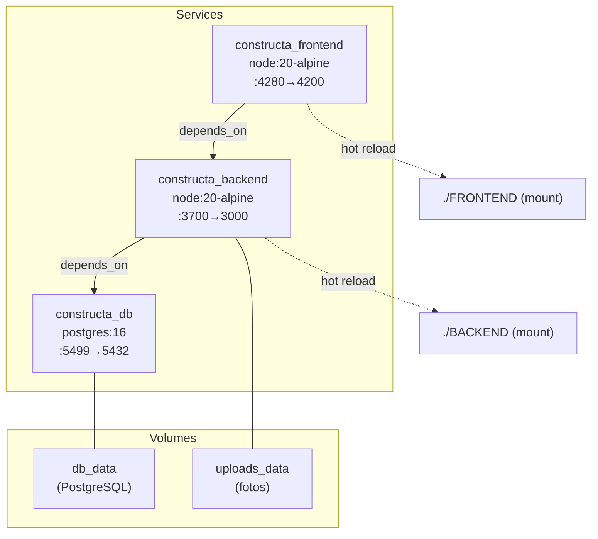

# Arquitectura del sistema

---

## Diagrama general



---

## Capas del backend



### Detalle de cada capa

| Capa | Responsabilidad | Archivos |
|---|---|---|
| **Middlewares** | Autenticacion JWT, validacion Zod, manejo de uploads, errores globales | `src/middlewares/` |
| **Routes** | Definicion de endpoints, Swagger JSDoc, binding a controllers | `src/routes/` |
| **Controllers** | Logica de negocio, queries, ownership check, respuestas HTTP | `src/controllers/` |
| **Entities** | Definicion de tablas, relaciones, columnas TypeORM | `src/entities/` |
| **Validators** | Esquemas Zod con mensajes en español | `src/validators/` |
| **Services** | Generacion de PDF (contrato) | `src/services/` |
| **Config** | DataSource TypeORM, Swagger setup | `src/config/` |

### CRUD Factory

Para entidades simples (Usuario, Cliente), existe un patron factory en `crud.factory.ts` que genera operaciones CRUD estandar (getAll, getById, create, update, remove) sin repetir codigo. Las entidades con logica de negocio compleja (Obra) tienen controllers dedicados.

---

## Capas del frontend



### Detalle de cada capa

| Capa | Responsabilidad | Ubicacion |
|---|---|---|
| **Features** | Componentes de pagina (Dashboard, ObraDetalle, Login) | `features/` |
| **Shared** | Layout, Sidebar, CrudPage generico, Dialogs | `shared/components/` |
| **Services** | Llamadas HTTP tipadas (ObraService, ReporteService, AuthService) | `core/services/` |
| **Store** | Estado reactivo con Signals (MaestroStore) | `core/services/maestro.store.ts` |
| **Models** | Interfaces TypeScript que matchean el backend | `core/models/` |
| **Guards** | Proteccion de rutas (authGuard) | `core/guards/` |
| **Interceptors** | Inyeccion automatica del token JWT | `core/interceptors/` |

### Patron de estado: Signals

El `MaestroStore` usa Angular Signals (no NgRx/RxJS stores) para un estado reactivo ligero:

```
signal(obras)          → lista de obras del maestro
signal(obraSeleccionada) → obra actualmente visualizada
computed(obrasActivas)   → filtro: estado != cancelada
computed(resumenFinanciero) → totales calculados en tiempo real
computed(progresoCobro)  → porcentaje de fases cobradas
```

Las acciones (cargar, crear, actualizar) usan ObraService internamente y actualizan los signals de forma optimista.

### Patron CRUD generico

Las paginas de CRUD (Clientes, Obras, Fases, Gastos) se generan a partir de un `entities.config.ts` que define:

```typescript
{
  title: 'Clientes',
  apiPath: 'clientes',
  columns: [
    { key: 'nombre', label: 'Nombre' },
    { key: 'telefono', label: 'Telefono' },
    ...
  ],
  formFields: [
    { key: 'nombre', label: 'Nombre', type: 'text', required: true },
    { key: 'usuario_id', label: 'Usuario', type: 'select', entitySource: 'usuarios' },
    ...
  ]
}
```

Un solo `CrudPageComponent` + `EntityFormDialogComponent` renderiza cualquier entidad.

---

## Flujo de autenticacion



---

## Flujo de subida de archivos



---

## Infraestructura Docker



| Servicio | Imagen | Puerto externo | Puerto interno |
|---|---|---|---|
| `constructa_db` | postgres:16 | 5499 | 5432 |
| `constructa_backend` | node:20-alpine | 3700 | 3000 |
| `constructa_frontend` | node:20-alpine | 4280 | 4200 |

### Volumenes

- **db_data** — Persistencia de PostgreSQL entre reinicios
- **uploads_data** — Fotos de evidencias y recibos
- **./BACKEND** y **./FRONTEND** — Mount de codigo fuente para hot reload en desarrollo
