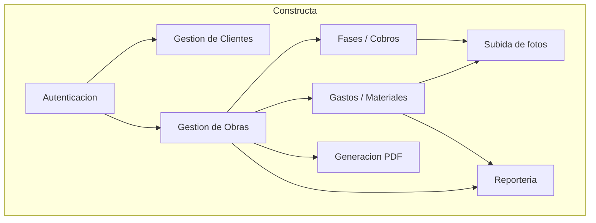
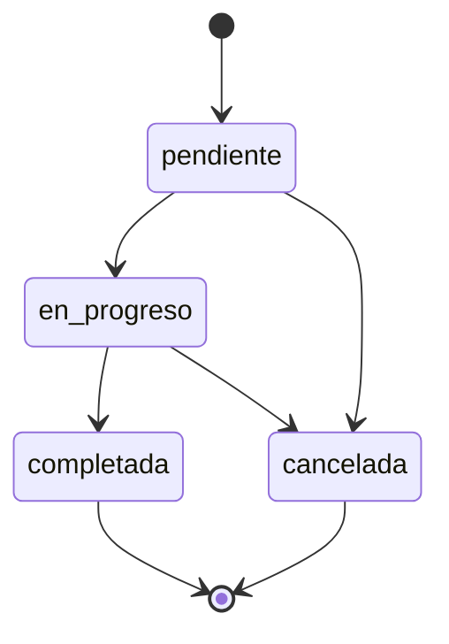
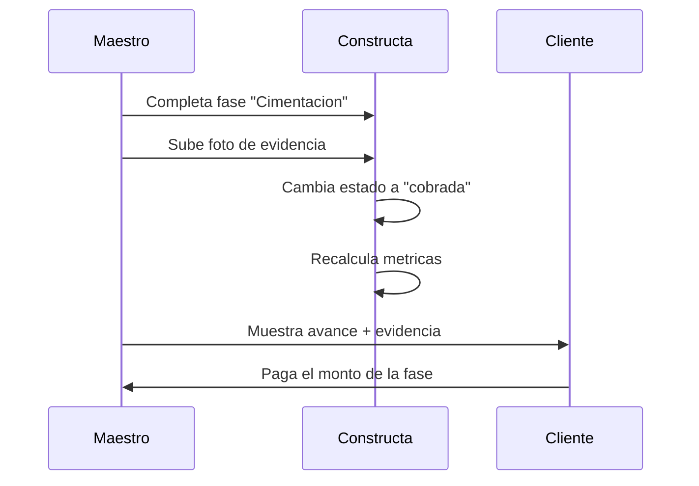
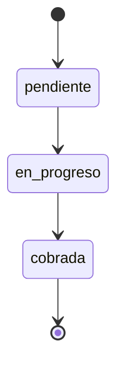
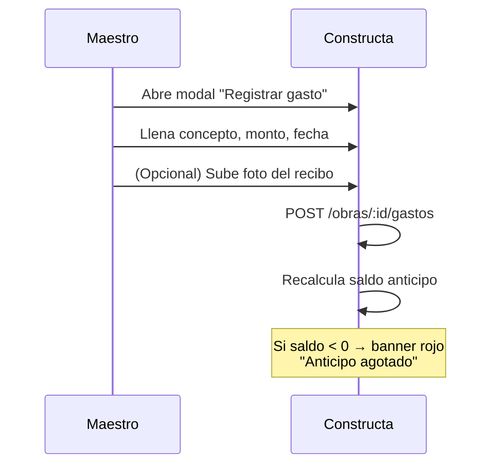
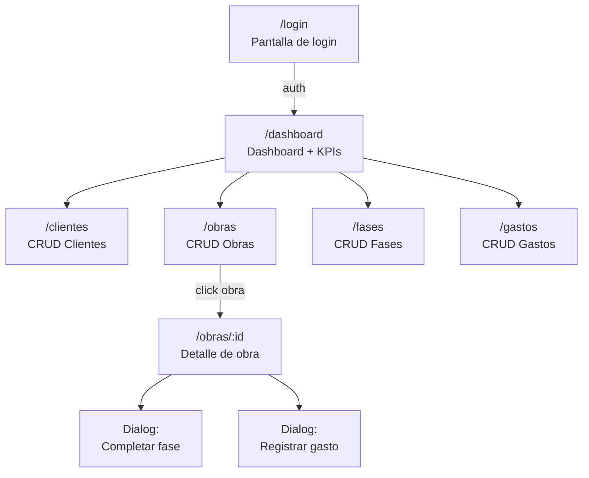

# Funcionalidades del sistema

---

## Modulos implementados



---

## 1. Autenticacion y sesion

**Objetivo:** Proteger el acceso al sistema y asociar cada operacion al maestro constructor autenticado.

| Funcionalidad | Descripcion |
|---|---|
| Login | Email + password. Devuelve JWT con 8 horas de vigencia |
| Sesion persistente | Token almacenado en localStorage. Se inyecta automaticamente via interceptor |
| Proteccion de rutas | Guard redirige a `/login` si no hay token valido |
| Ownership | Cada query filtra por `usuario_id` del token. Un maestro solo ve sus propios datos |

### Flujo

1. El maestro abre la app → ve pantalla de login
2. Ingresa credenciales → backend valida contra hash bcrypt
3. Recibe JWT → se guarda en localStorage
4. Navega al dashboard → todas las llamadas llevan el token
5. Si el token expira → la siguiente llamada devuelve 401 → redirige a login

---

## 2. Gestion de clientes

**Objetivo:** Registrar los clientes (dueños de obra) con los que trabaja el maestro.

| Campo | Obligatorio | Descripcion |
|---|---|---|
| Nombre | Si | Nombre completo del cliente |
| Telefono | No | Numero de contacto |
| Direccion | No | Direccion de la obra o domicilio |
| Notas | No | Observaciones (ej: "prefiere llamadas por la mañana") |

### Reglas de negocio

- Cada cliente pertenece a un usuario (maestro)
- Un cliente puede tener multiples obras
- No se puede eliminar un cliente que tenga obras asociadas

---

## 3. Gestion de obras

**Objetivo:** Registrar y administrar cada proyecto de construccion con su presupuesto.

### Datos de una obra

| Campo | Descripcion |
|---|---|
| Nombre | Descripcion corta de la obra (ej: "Ampliacion segundo piso") |
| Cliente | A quien pertenece la obra |
| Presupuesto mano de obra | Lo que el maestro cobrara por su trabajo |
| Anticipo de materiales | Dinero que el cliente entrega para comprar materiales |
| Estado | pendiente → en_progreso → completada / cancelada |
| Fecha inicio / fin | Opcionales, para referencia |

### Metricas calculadas (en tiempo real)

| Metrica | Formula |
|---|---|
| Total contrato | presupuesto_mano_obra + anticipo_materiales |
| Total gastado | SUM(gastos.monto) de la obra |
| Saldo anticipo | anticipo_materiales - total_gastado |
| Monto cobrado | SUM(fases.monto_a_cobrar) WHERE estado = 'cobrada' |
| Monto por cobrar | SUM(fases.monto_a_cobrar) WHERE estado != 'cobrada' |
| Progreso | (fases_cobradas / total_fases) * 100 |

### Estados y transiciones



### Reglas de negocio

- El `usuario_id` se asigna automaticamente desde el JWT (el maestro no lo elige)
- No se puede eliminar una obra que tenga fases en estado `cobrada`
- Al cambiar estado se usa el endpoint `PATCH /estado` (no PUT completo)

---

## 4. Fases de cobro

**Objetivo:** Dividir el cobro de una obra en hitos/etapas que el maestro va completando.

### Ejemplo real

Para una obra de "Ampliacion segundo piso" con presupuesto de $4,500:

| Orden | Fase | Monto | Estado |
|---|---|---|---|
| 1 | Cimentacion completada | $1,200 | cobrada |
| 2 | Paredes de bloque levantadas | $1,000 | en_progreso |
| 3 | Losa de techo fundida | $1,500 | pendiente |
| 4 | Acabados y entrega | $800 | pendiente |

### Flujo de cobro



### Estados de una fase



### Reglas de negocio

- Las fases se ordenan por el campo `orden`
- Al marcar una fase como `cobrada`, se puede adjuntar una URL de foto como evidencia
- El endpoint `PATCH /obras/:id/fases/:faseId` solo permite cambiar `estado` y `url_evidencia_foto`
- La suma de `monto_a_cobrar` de todas las fases deberia aproximarse al presupuesto de mano de obra

---

## 5. Registro de gastos

**Objetivo:** Llevar un registro de cada gasto de materiales para saber cuanto se ha consumido del anticipo.

### Datos de un gasto

| Campo | Obligatorio | Descripcion |
|---|---|---|
| Concepto | Si | Que se compro (ej: "20 sacos de cemento") |
| Monto | Si | Valor en dolares |
| Fecha | Si | Cuando se hizo la compra |
| Foto del recibo | No | URL de la imagen del recibo/factura |

### Flujo de registro



### Reglas de negocio

- El gasto siempre esta vinculado a una obra
- El `monto` debe ser mayor a 0
- La fecha tiene formato YYYY-MM-DD
- Si el total de gastos supera el anticipo, la UI muestra un banner de alerta

---

## 6. Reporteria financiera

**Objetivo:** Darle al maestro visibilidad en tiempo real de su situacion economica.

### 6.1 Resumen de obra

Endpoint: `GET /reportes/resumen-obra/:obraId`

Calcula usando SQL aggregations (no carga todos los registros en memoria):

```
Presupuesto
├── Mano de obra:     $4,500
├── Anticipo mat.:    $3,000
└── Total contrato:   $7,500

Gastos
├── Total gastado:    $1,913  (10 gastos)
└── Saldo anticipo:   $1,087

Cobros
├── Cobrado:          $1,200  (1 fase)
├── Por cobrar:       $3,300  (3 fases)
└── Progreso:         25%

Balance
├── Ingreso neto:     -$713   (cobrado - gastado)
└── Rentabilidad:     -15.8%
```

### 6.2 Gastos mensuales

Endpoint: `GET /reportes/gastos-mensuales?anio=2026`

Agrupa gastos por mes usando `EXTRACT(MONTH)`. Devuelve los 12 meses (incluyendo meses con $0) para facilitar graficos de barras:

```
Ene: $0  |  Feb: $450  |  Mar: $1,463  |  Abr: $0  | ...
```

### 6.3 Dashboard (Frontend)

El dashboard muestra:

| Componente | Datos |
|---|---|
| KPI Cards | Total gastado, Liquidez restante, Por cobrar, Ingreso neto |
| Grafico de barras | Gastos mensuales del año actual |
| Grafico de dona | Presupuesto vs Gastado (obras activas) |
| Contadores | Clientes, Obras, Fases totales |

---

## 7. Generacion de PDF (Hoja de Obra)

**Objetivo:** Generar un documento formal que el maestro pueda compartir con el cliente como contrato informal.

Endpoint: `GET /obras/:id/contrato-pdf`

### Contenido del PDF

1. **Encabezado** — Logo Constructa + titulo "Hoja de Obra"
2. **Datos del maestro** — Nombre, email, telefono
3. **Datos del cliente** — Nombre, telefono, direccion
4. **Informacion de la obra** — Nombre, descripcion, estado, fechas
5. **Resumen financiero** — Barra de total contrato con desglose mano de obra / anticipo
6. **Tabla de fases** — Orden, nombre, monto, estado con badges de color
7. **Condiciones generales** — Texto estandar sobre forma de pago
8. **Firmas** — Espacios para firma del maestro y del cliente
9. **Pie de pagina** — "Constructa — Documento generado el DD/MM/YYYY"

### Caracteristicas tecnicas

- Generado con pdfkit, streamed directo al response (sin guardar en disco)
- Formato A4
- Paleta Indigo/Teal consistente con la UI
- Maneja page breaks automaticos para listas largas de fases

---

## 8. Subida de archivos

**Objetivo:** Permitir al maestro adjuntar fotos de evidencias (fases completadas) y recibos (gastos).

### Especificaciones

| Parametro | Valor |
|---|---|
| Formatos | JPEG, PNG, WebP, HEIC, HEIF |
| Tamaño maximo | 5 MB |
| Storage | Disco local (`/uploads`) con Docker volume |
| Acceso | URL publica: `http://host/uploads/filename.jpg` |

### Flujo de dos pasos

1. **Subir archivo** → `POST /upload` → devuelve `{ url }`
2. **Usar URL** → se envia como campo en el form de fase/gasto

Este patron desacopla la subida del guardado de la entidad.

---

## Mapa de navegacion (Frontend)



### Componentes de UI

- **Layout**: Sidenav responsive (drawer en mobile, panel fijo en desktop)
- **CrudPage generico**: Tabla con filtros, paginacion, y dialogs de crear/editar/eliminar
- **ObraDetalle**: Vista mobile-first con cards financieras, barra de progreso, tabs de Fases/Gastos
- **Dialogs**: Modales centrados (95vw mobile, 400px max) con formularios reactivos
