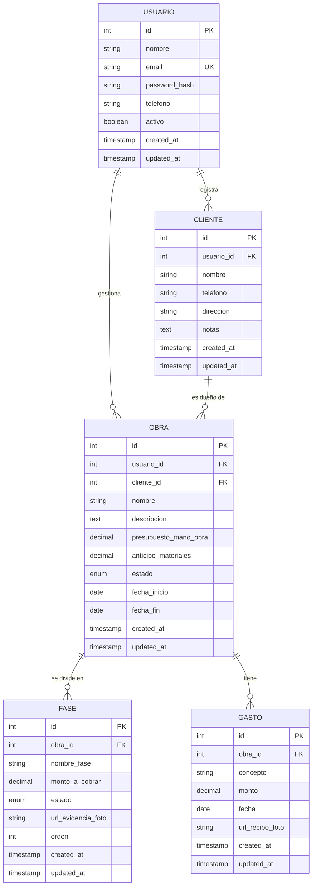

# Modelo de datos

El MVP de Constructa implementa **5 entidades** que cubren el flujo completo del maestro constructor: autenticarse, registrar clientes, crear obras, dividirlas en fases de cobro y registrar gastos de materiales.

---

## Diagrama Entidad-Relacion

---

## Detalle de entidades

### 1. USUARIO

Representa al maestro constructor que usa la aplicacion.

| Campo | Tipo | Nullable | Descripcion |
|---|---|---|---|
| `id` | int (PK, auto) | No | Identificador unico |
| `nombre` | varchar(200) | No | Nombre completo |
| `email` | varchar(200, unique) | No | Correo para login |
| `password_hash` | varchar(255) | No | Hash bcrypt del password |
| `telefono` | varchar(20) | Si | Numero de contacto |
| `activo` | boolean (default true) | No | Si puede hacer login |
| `created_at` | timestamp | No | Fecha de creacion |
| `updated_at` | timestamp | No | Ultima actualizacion |

**Relaciones:**
- `1:N` → Cliente (un maestro tiene muchos clientes)
- `1:N` → Obra (un maestro gestiona muchas obras)

---

### 2. CLIENTE

Persona dueña de la obra que contrata al maestro.

| Campo | Tipo | Nullable | Descripcion |
|---|---|---|---|
| `id` | int (PK, auto) | No | Identificador unico |
| `usuario_id` | int (FK → Usuario) | No | Maestro al que pertenece |
| `nombre` | varchar(200) | No | Nombre completo del cliente |
| `telefono` | varchar(20) | Si | Telefono de contacto |
| `direccion` | varchar(300) | Si | Direccion de la obra o domicilio |
| `notas` | text | Si | Observaciones libres |
| `created_at` | timestamp | No | Fecha de creacion |
| `updated_at` | timestamp | No | Ultima actualizacion |

**Relaciones:**
- `N:1` → Usuario (pertenece a un maestro)
- `1:N` → Obra (un cliente puede tener varias obras)

---

### 3. OBRA

Proyecto de construccion con presupuesto definido.

| Campo | Tipo | Nullable | Descripcion |
|---|---|---|---|
| `id` | int (PK, auto) | No | Identificador unico |
| `usuario_id` | int (FK → Usuario) | No | Maestro que gestiona la obra |
| `cliente_id` | int (FK → Cliente) | No | Dueño de la obra |
| `nombre` | varchar(200) | No | Nombre descriptivo (ej: "Ampliacion 2do piso") |
| `descripcion` | text | Si | Detalle de los trabajos |
| `presupuesto_mano_obra` | decimal(10,2) | No | Lo que cobrara el maestro |
| `anticipo_materiales` | decimal(10,2) | No | Dinero entregado para materiales |
| `estado` | enum | No | `pendiente` / `en_progreso` / `completada` / `cancelada` |
| `fecha_inicio` | date | Si | Inicio planificado |
| `fecha_fin` | date | Si | Fin estimado |
| `created_at` | timestamp | No | Fecha de creacion |
| `updated_at` | timestamp | No | Ultima actualizacion |

**Relaciones:**
- `N:1` → Usuario (pertenece a un maestro)
- `N:1` → Cliente (pertenece a un cliente)
- `1:N` → Fase (se divide en fases de cobro)
- `1:N` → Gasto (tiene gastos de materiales)

**Campos calculados (no almacenados):**
- `total_contrato` = presupuesto_mano_obra + anticipo_materiales
- `total_gastado` = SUM(gastos.monto)
- `saldo_anticipo` = anticipo_materiales - total_gastado
- `monto_cobrado` = SUM(fases.monto_a_cobrar WHERE estado = 'cobrada')
- `monto_pendiente` = SUM(fases.monto_a_cobrar WHERE estado != 'cobrada')

---

### 4. FASE

Hito o etapa de cobro dentro de una obra. Cada fase representa un trabajo especifico que al completarse habilita un cobro al cliente.

| Campo | Tipo | Nullable | Descripcion |
|---|---|---|---|
| `id` | int (PK, auto) | No | Identificador unico |
| `obra_id` | int (FK → Obra) | No | Obra a la que pertenece |
| `nombre_fase` | varchar(200) | No | Descripcion del hito (ej: "Losa de techo fundida") |
| `monto_a_cobrar` | decimal(10,2) | No | Cuanto se cobra al completar |
| `estado` | enum | No | `pendiente` / `en_progreso` / `cobrada` |
| `url_evidencia_foto` | varchar(500) | Si | URL de foto que demuestra trabajo completado |
| `orden` | int (default 1) | No | Posicion en la secuencia de fases |
| `created_at` | timestamp | No | Fecha de creacion |
| `updated_at` | timestamp | No | Ultima actualizacion |

**Relaciones:**
- `N:1` → Obra (pertenece a una obra)

---

### 5. GASTO

Registro de una compra de materiales o insumo para una obra.

| Campo | Tipo | Nullable | Descripcion |
|---|---|---|---|
| `id` | int (PK, auto) | No | Identificador unico |
| `obra_id` | int (FK → Obra) | No | Obra a la que se imputa |
| `concepto` | varchar(300) | No | Que se compro (ej: "20 sacos de cemento") |
| `monto` | decimal(10,2) | No | Valor de la compra |
| `fecha` | date | No | Cuando se compro |
| `url_recibo_foto` | varchar(500) | Si | URL de foto del recibo o factura |
| `created_at` | timestamp | No | Fecha de creacion |
| `updated_at` | timestamp | No | Ultima actualizacion |

**Relaciones:**
- `N:1` → Obra (pertenece a una obra)

---

## Tipos enumerados

### EstadoObra

| Valor | Significado |
|---|---|
| `pendiente` | Obra creada pero no iniciada |
| `en_progreso` | Obra en ejecucion activa |
| `completada` | Todos los trabajos finalizados |
| `cancelada` | Obra cancelada por cualquier razon |

### EstadoFase

| Valor | Significado |
|---|---|
| `pendiente` | Fase aun no iniciada |
| `en_progreso` | Trabajo de la fase en curso |
| `cobrada` | Fase completada y cobrada al cliente |

---

## Datos de prueba (seed)

El sistema incluye un seed automatico que crea datos realistas para pruebas:

### Usuario
- **Luis Martinez** — luis@obra.com / Luis123!

### Clientes (3)
- Sra. Martha Paredes — Guayaquil
- Don Ricardo Espinoza — Samborondon
- Ing. Patricia Loor — Duran

### Obras (3)

| Obra | Cliente | Mano de obra | Anticipo | Estado |
|---|---|---|---|---|
| Ampliacion segundo piso | Martha | $4,500 | $3,000 | en_progreso |
| Remodelacion cocina y baño | Ricardo | $2,800 | $1,500 | pendiente |
| Cerramiento perimetral | Patricia | $3,200 | $2,000 | completada |

### Fases (10 total, distribuidas entre las 3 obras)
### Gastos (15+ registros de materiales: cemento, varilla, bloques, arena, etc.)

---

## Nota sobre el diseno original

El diseno teorico del sistema contemplaba **21 entidades** organizadas en 4 modulos (Proyectos/Contratos, Hitos/Materiales, Pagos/Cobros, Usuarios). Esa documentacion se mantiene como referencia en:

- [README_ENTIDADES.md](./README_ENTIDADES.md) — Las 21 entidades con campos y justificaciones
- [README_SQL.md](./README_SQL.md) — DDL completo y ERD Mermaid

El MVP implementa las 5 entidades que resuelven el caso de uso principal del maestro constructor.
