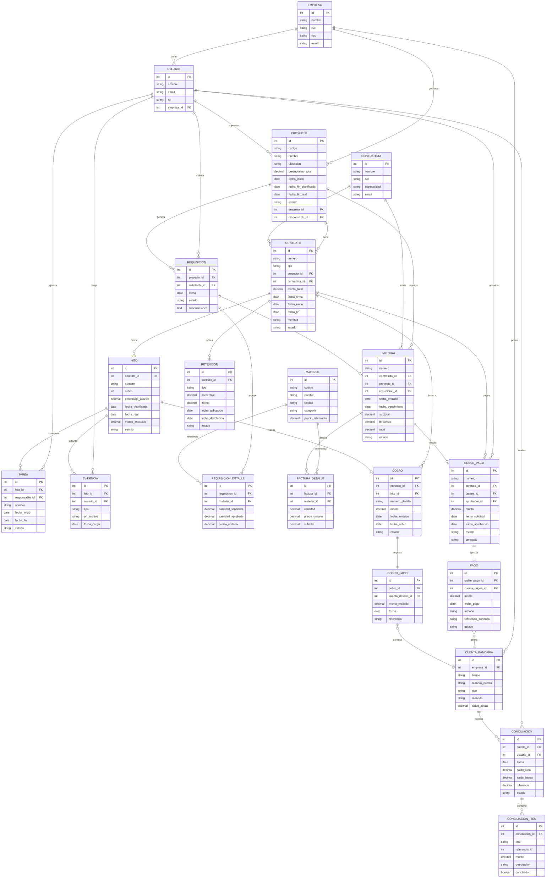

# Esquema SQL y diagrama de base de datos

DDL completo del sistema de gestión de construcciones. Compatible con **PostgreSQL 15+**. Incluye todas las tablas, constraints, índices y el diagrama ERD.

---

## Índice

- [Diagrama ERD](#diagrama-erd)
- [DDL — Módulo 1: Proyectos y contratos](#ddl--módulo-1-proyectos-y-contratos)
- [DDL — Módulo 2: Hitos y materiales](#ddl--módulo-2-hitos-y-materiales)
- [DDL — Módulo 3: Pagos y cobros](#ddl--módulo-3-pagos-y-cobros)
- [DDL — Módulo 4: Usuarios](#ddl--módulo-4-usuarios)
- [Índices recomendados](#índices-recomendados)
- [Notas de implementación](#notas-de-implementación)

---

## Diagrama ERD



---

## DDL — Módulo 4: Usuarios

> Se crea primero porque es referenciado por casi todas las demás tablas.

```sql
-- ============================================================
-- MÓDULO 4: USUARIOS Y ACCESO
-- ============================================================

CREATE TABLE empresa (
    id               SERIAL PRIMARY KEY,
    nombre           VARCHAR(200) NOT NULL,
    ruc              VARCHAR(20)  NOT NULL UNIQUE,
    direccion        VARCHAR(300),
    telefono         VARCHAR(20),
    email            VARCHAR(100) NOT NULL,
    tipo             VARCHAR(50)  NOT NULL DEFAULT 'privada'
                     CHECK (tipo IN ('publica', 'privada', 'mixta')),
    created_at       TIMESTAMP NOT NULL DEFAULT NOW(),
    updated_at       TIMESTAMP NOT NULL DEFAULT NOW()
);

CREATE TABLE usuario (
    id               SERIAL PRIMARY KEY,
    empresa_id       INT NOT NULL REFERENCES empresa(id),
    nombre           VARCHAR(150) NOT NULL,
    email            VARCHAR(100) NOT NULL UNIQUE,
    password_hash    VARCHAR(255) NOT NULL,
    rol              VARCHAR(50)  NOT NULL DEFAULT 'operativo'
                     CHECK (rol IN ('admin', 'gerente', 'supervisor',
                                    'financiero', 'operativo')),
    activo           BOOLEAN NOT NULL DEFAULT TRUE,
    created_at       TIMESTAMP NOT NULL DEFAULT NOW(),
    updated_at       TIMESTAMP NOT NULL DEFAULT NOW()
);
```

---

## DDL — Módulo 1: Proyectos y contratos

```sql
-- ============================================================
-- MÓDULO 1: PROYECTOS Y CONTRATOS
-- ============================================================

CREATE TABLE contratista (
    id               SERIAL PRIMARY KEY,
    nombre           VARCHAR(200) NOT NULL,
    ruc              VARCHAR(20)  NOT NULL UNIQUE,
    especialidad     VARCHAR(100),
    contacto         VARCHAR(150),
    email            VARCHAR(100),
    created_at       TIMESTAMP NOT NULL DEFAULT NOW(),
    updated_at       TIMESTAMP NOT NULL DEFAULT NOW()
);

CREATE TABLE proyecto (
    id                      SERIAL PRIMARY KEY,
    empresa_id              INT NOT NULL REFERENCES empresa(id),
    responsable_id          INT NOT NULL REFERENCES usuario(id),
    codigo                  VARCHAR(50)  NOT NULL UNIQUE,
    nombre                  VARCHAR(200) NOT NULL,
    descripcion             TEXT,
    ubicacion               VARCHAR(300),
    presupuesto_total       NUMERIC(18,2) NOT NULL DEFAULT 0,
    fecha_inicio            DATE NOT NULL,
    fecha_fin_planificada   DATE NOT NULL,
    fecha_fin_real          DATE,
    estado                  VARCHAR(30) NOT NULL DEFAULT 'planificado'
                            CHECK (estado IN ('planificado', 'en_ejecucion',
                                              'pausado', 'cerrado')),
    created_at              TIMESTAMP NOT NULL DEFAULT NOW(),
    updated_at              TIMESTAMP NOT NULL DEFAULT NOW()
);

CREATE TABLE contrato (
    id               SERIAL PRIMARY KEY,
    proyecto_id      INT NOT NULL REFERENCES proyecto(id),
    contratista_id   INT NOT NULL REFERENCES contratista(id),
    numero           VARCHAR(50)  NOT NULL UNIQUE,
    tipo             VARCHAR(50)  NOT NULL
                     CHECK (tipo IN ('obra', 'suministro',
                                     'consultoria', 'mixto')),
    monto_total      NUMERIC(18,2) NOT NULL,
    fecha_firma      DATE NOT NULL,
    fecha_inicio     DATE NOT NULL,
    fecha_fin        DATE NOT NULL,
    moneda           VARCHAR(10)  NOT NULL DEFAULT 'USD',
    estado           VARCHAR(30)  NOT NULL DEFAULT 'vigente'
                     CHECK (estado IN ('borrador', 'vigente',
                                       'liquidado', 'terminado')),
    clausulas        TEXT,
    created_at       TIMESTAMP NOT NULL DEFAULT NOW(),
    updated_at       TIMESTAMP NOT NULL DEFAULT NOW()
);
```

---

## DDL — Módulo 2: Hitos y materiales

```sql
-- ============================================================
-- MÓDULO 2: HITOS, TAREAS Y MATERIALES
-- ============================================================

CREATE TABLE hito (
    id                  SERIAL PRIMARY KEY,
    contrato_id         INT NOT NULL REFERENCES contrato(id),
    nombre              VARCHAR(200) NOT NULL,
    descripcion         TEXT,
    orden               INT NOT NULL DEFAULT 1,
    porcentaje_avance   NUMERIC(5,2) NOT NULL DEFAULT 0
                        CHECK (porcentaje_avance BETWEEN 0 AND 100),
    fecha_planificada   DATE NOT NULL,
    fecha_real          DATE,
    monto_asociado      NUMERIC(18,2) NOT NULL DEFAULT 0,
    estado              VARCHAR(30) NOT NULL DEFAULT 'pendiente'
                        CHECK (estado IN ('pendiente', 'en_progreso',
                                          'completado', 'rechazado')),
    created_at          TIMESTAMP NOT NULL DEFAULT NOW(),
    updated_at          TIMESTAMP NOT NULL DEFAULT NOW()
);

CREATE TABLE tarea (
    id               SERIAL PRIMARY KEY,
    hito_id          INT NOT NULL REFERENCES hito(id),
    responsable_id   INT NOT NULL REFERENCES usuario(id),
    nombre           VARCHAR(200) NOT NULL,
    fecha_inicio     DATE NOT NULL,
    fecha_fin        DATE NOT NULL,
    estado           VARCHAR(30) NOT NULL DEFAULT 'pendiente'
                     CHECK (estado IN ('pendiente', 'en_progreso', 'completada')),
    observaciones    TEXT,
    created_at       TIMESTAMP NOT NULL DEFAULT NOW(),
    updated_at       TIMESTAMP NOT NULL DEFAULT NOW()
);

CREATE TABLE evidencia (
    id               SERIAL PRIMARY KEY,
    hito_id          INT NOT NULL REFERENCES hito(id),
    usuario_id       INT NOT NULL REFERENCES usuario(id),
    tipo             VARCHAR(50) NOT NULL
                     CHECK (tipo IN ('foto', 'acta', 'informe', 'certificado')),
    url_archivo      VARCHAR(500) NOT NULL,
    fecha_carga      DATE NOT NULL DEFAULT CURRENT_DATE,
    created_at       TIMESTAMP NOT NULL DEFAULT NOW()
);

CREATE TABLE material (
    id                  SERIAL PRIMARY KEY,
    codigo              VARCHAR(50)  NOT NULL UNIQUE,
    nombre              VARCHAR(200) NOT NULL,
    unidad              VARCHAR(30)  NOT NULL,
    categoria           VARCHAR(100),
    precio_referencial  NUMERIC(18,2) NOT NULL DEFAULT 0,
    created_at          TIMESTAMP NOT NULL DEFAULT NOW(),
    updated_at          TIMESTAMP NOT NULL DEFAULT NOW()
);

CREATE TABLE requisicion (
    id               SERIAL PRIMARY KEY,
    proyecto_id      INT NOT NULL REFERENCES proyecto(id),
    solicitante_id   INT NOT NULL REFERENCES usuario(id),
    fecha            DATE NOT NULL DEFAULT CURRENT_DATE,
    estado           VARCHAR(30) NOT NULL DEFAULT 'borrador'
                     CHECK (estado IN ('borrador', 'pendiente',
                                       'aprobada', 'rechazada')),
    observaciones    TEXT,
    created_at       TIMESTAMP NOT NULL DEFAULT NOW(),
    updated_at       TIMESTAMP NOT NULL DEFAULT NOW()
);

CREATE TABLE requisicion_detalle (
    id                   SERIAL PRIMARY KEY,
    requisicion_id       INT NOT NULL REFERENCES requisicion(id),
    material_id          INT NOT NULL REFERENCES material(id),
    cantidad_solicitada  NUMERIC(14,4) NOT NULL,
    cantidad_aprobada    NUMERIC(14,4),
    precio_unitario      NUMERIC(18,2) NOT NULL DEFAULT 0
);

CREATE TABLE factura (
    id               SERIAL PRIMARY KEY,
    contratista_id   INT NOT NULL REFERENCES contratista(id),
    proyecto_id      INT NOT NULL REFERENCES proyecto(id),
    requisicion_id   INT REFERENCES requisicion(id),
    numero           VARCHAR(50)  NOT NULL,
    fecha_emision    DATE NOT NULL,
    fecha_vencimiento DATE NOT NULL,
    subtotal         NUMERIC(18,2) NOT NULL DEFAULT 0,
    impuesto         NUMERIC(18,2) NOT NULL DEFAULT 0,
    total            NUMERIC(18,2) NOT NULL DEFAULT 0,
    estado           VARCHAR(30) NOT NULL DEFAULT 'recibida'
                     CHECK (estado IN ('recibida', 'verificada',
                                       'pagada', 'anulada')),
    created_at       TIMESTAMP NOT NULL DEFAULT NOW(),
    updated_at       TIMESTAMP NOT NULL DEFAULT NOW()
);

CREATE TABLE factura_detalle (
    id               SERIAL PRIMARY KEY,
    factura_id       INT NOT NULL REFERENCES factura(id),
    material_id      INT NOT NULL REFERENCES material(id),
    cantidad         NUMERIC(14,4) NOT NULL,
    precio_unitario  NUMERIC(18,2) NOT NULL,
    subtotal         NUMERIC(18,2) NOT NULL
);
```

---

## DDL — Módulo 3: Pagos y cobros

```sql
-- ============================================================
-- MÓDULO 3: PAGOS, COBROS Y CONTROL FINANCIERO
-- ============================================================

CREATE TABLE cuenta_bancaria (
    id               SERIAL PRIMARY KEY,
    empresa_id       INT NOT NULL REFERENCES empresa(id),
    banco            VARCHAR(100) NOT NULL,
    numero_cuenta    VARCHAR(50)  NOT NULL UNIQUE,
    tipo             VARCHAR(20)  NOT NULL DEFAULT 'corriente'
                     CHECK (tipo IN ('corriente', 'ahorros')),
    moneda           VARCHAR(10)  NOT NULL DEFAULT 'USD',
    saldo_actual     NUMERIC(18,2) NOT NULL DEFAULT 0,
    created_at       TIMESTAMP NOT NULL DEFAULT NOW(),
    updated_at       TIMESTAMP NOT NULL DEFAULT NOW()
);

CREATE TABLE orden_pago (
    id                  SERIAL PRIMARY KEY,
    contrato_id         INT NOT NULL REFERENCES contrato(id),
    factura_id          INT NOT NULL REFERENCES factura(id),
    aprobador_id        INT REFERENCES usuario(id),
    numero              VARCHAR(50)  NOT NULL UNIQUE,
    monto               NUMERIC(18,2) NOT NULL,
    fecha_solicitud     DATE NOT NULL DEFAULT CURRENT_DATE,
    fecha_aprobacion    DATE,
    estado              VARCHAR(30) NOT NULL DEFAULT 'borrador'
                        CHECK (estado IN ('borrador', 'pendiente', 'aprobada',
                                          'rechazada', 'pagada')),
    concepto            VARCHAR(300),
    created_at          TIMESTAMP NOT NULL DEFAULT NOW(),
    updated_at          TIMESTAMP NOT NULL DEFAULT NOW()
);

CREATE TABLE pago (
    id                   SERIAL PRIMARY KEY,
    orden_pago_id        INT NOT NULL REFERENCES orden_pago(id),
    cuenta_origen_id     INT NOT NULL REFERENCES cuenta_bancaria(id),
    monto                NUMERIC(18,2) NOT NULL,
    fecha_pago           DATE NOT NULL,
    metodo               VARCHAR(30) NOT NULL
                         CHECK (metodo IN ('transferencia', 'cheque', 'efectivo')),
    referencia_bancaria  VARCHAR(100),
    comprobante_url      VARCHAR(500),
    estado               VARCHAR(30) NOT NULL DEFAULT 'procesado'
                         CHECK (estado IN ('procesado', 'devuelto', 'anulado')),
    created_at           TIMESTAMP NOT NULL DEFAULT NOW()
);

CREATE TABLE cobro (
    id               SERIAL PRIMARY KEY,
    contrato_id      INT NOT NULL REFERENCES contrato(id),
    hito_id          INT NOT NULL REFERENCES hito(id),
    numero_planilla  VARCHAR(50) NOT NULL UNIQUE,
    monto            NUMERIC(18,2) NOT NULL,
    fecha_emision    DATE NOT NULL DEFAULT CURRENT_DATE,
    fecha_cobro      DATE,
    estado           VARCHAR(30) NOT NULL DEFAULT 'emitida'
                     CHECK (estado IN ('emitida', 'aprobada',
                                       'cobrada', 'rechazada')),
    created_at       TIMESTAMP NOT NULL DEFAULT NOW(),
    updated_at       TIMESTAMP NOT NULL DEFAULT NOW()
);

CREATE TABLE cobro_pago (
    id                   SERIAL PRIMARY KEY,
    cobro_id             INT NOT NULL REFERENCES cobro(id),
    cuenta_destino_id    INT NOT NULL REFERENCES cuenta_bancaria(id),
    monto_recibido       NUMERIC(18,2) NOT NULL,
    fecha                DATE NOT NULL DEFAULT CURRENT_DATE,
    referencia           VARCHAR(100),
    created_at           TIMESTAMP NOT NULL DEFAULT NOW()
);

CREATE TABLE retencion (
    id                  SERIAL PRIMARY KEY,
    contrato_id         INT NOT NULL REFERENCES contrato(id),
    tipo                VARCHAR(60) NOT NULL
                        CHECK (tipo IN ('garantia_cumplimiento',
                                        'fondo_garantia', 'otro')),
    porcentaje          NUMERIC(5,2) NOT NULL,
    monto               NUMERIC(18,2) NOT NULL,
    fecha_aplicacion    DATE NOT NULL,
    fecha_devolucion    DATE,
    estado              VARCHAR(30) NOT NULL DEFAULT 'activa'
                        CHECK (estado IN ('activa', 'devuelta', 'ejecutada')),
    created_at          TIMESTAMP NOT NULL DEFAULT NOW(),
    updated_at          TIMESTAMP NOT NULL DEFAULT NOW()
);

CREATE TABLE conciliacion (
    id               SERIAL PRIMARY KEY,
    cuenta_id        INT NOT NULL REFERENCES cuenta_bancaria(id),
    usuario_id       INT NOT NULL REFERENCES usuario(id),
    fecha            DATE NOT NULL,
    saldo_libro      NUMERIC(18,2) NOT NULL,
    saldo_banco      NUMERIC(18,2) NOT NULL,
    diferencia       NUMERIC(18,2) GENERATED ALWAYS AS
                     (saldo_banco - saldo_libro) STORED,
    estado           VARCHAR(30) NOT NULL DEFAULT 'en_proceso'
                     CHECK (estado IN ('en_proceso', 'conciliada',
                                       'con_diferencias')),
    created_at       TIMESTAMP NOT NULL DEFAULT NOW(),
    updated_at       TIMESTAMP NOT NULL DEFAULT NOW()
);

CREATE TABLE conciliacion_item (
    id                  SERIAL PRIMARY KEY,
    conciliacion_id     INT NOT NULL REFERENCES conciliacion(id),
    tipo                VARCHAR(30) NOT NULL
                        CHECK (tipo IN ('pago', 'cobro',
                                        'ajuste', 'cargo_bancario')),
    referencia_id       INT,
    monto               NUMERIC(18,2) NOT NULL,
    descripcion         VARCHAR(300),
    conciliado          BOOLEAN NOT NULL DEFAULT FALSE,
    created_at          TIMESTAMP NOT NULL DEFAULT NOW()
);
```

---

## Índices recomendados

```sql
-- Proyectos y contratos
CREATE INDEX idx_proyecto_empresa     ON proyecto(empresa_id);
CREATE INDEX idx_proyecto_estado      ON proyecto(estado);
CREATE INDEX idx_contrato_proyecto    ON contrato(proyecto_id);
CREATE INDEX idx_contrato_contratista ON contrato(contratista_id);
CREATE INDEX idx_contrato_estado      ON contrato(estado);

-- Hitos y tareas
CREATE INDEX idx_hito_contrato        ON hito(contrato_id);
CREATE INDEX idx_hito_estado          ON hito(estado);
CREATE INDEX idx_tarea_hito           ON tarea(hito_id);
CREATE INDEX idx_tarea_responsable    ON tarea(responsable_id);
CREATE INDEX idx_evidencia_hito       ON evidencia(hito_id);

-- Materiales
CREATE INDEX idx_requi_proyecto       ON requisicion(proyecto_id);
CREATE INDEX idx_requi_estado         ON requisicion(estado);
CREATE INDEX idx_requi_det_material   ON requisicion_detalle(material_id);
CREATE INDEX idx_factura_proyecto     ON factura(proyecto_id);
CREATE INDEX idx_factura_estado       ON factura(estado);
CREATE INDEX idx_factura_vencimiento  ON factura(fecha_vencimiento);

-- Pagos y cobros
CREATE INDEX idx_orden_pago_contrato  ON orden_pago(contrato_id);
CREATE INDEX idx_orden_pago_estado    ON orden_pago(estado);
CREATE INDEX idx_pago_orden           ON pago(orden_pago_id);
CREATE INDEX idx_pago_cuenta          ON pago(cuenta_origen_id);
CREATE INDEX idx_cobro_contrato       ON cobro(contrato_id);
CREATE INDEX idx_cobro_hito           ON cobro(hito_id);
CREATE INDEX idx_cobro_estado         ON cobro(estado);
CREATE INDEX idx_conciliacion_cuenta  ON conciliacion(cuenta_id);
CREATE INDEX idx_conciliacion_fecha   ON conciliacion(fecha);
```

---

## Notas de implementación

### Columna `diferencia` calculada

En PostgreSQL, `diferencia` en `CONCILIACION` se define como columna generada (`GENERATED ALWAYS AS`). En Oracle se puede implementar con una columna virtual o un trigger.

### Actualización de `saldo_actual`

El campo `saldo_actual` en `CUENTA_BANCARIA` debe actualizarse mediante triggers o en la capa de aplicación tras cada inserción en `PAGO` y `COBRO_PAGO`:

```sql
-- Trigger ejemplo para actualizar saldo tras un pago
CREATE OR REPLACE FUNCTION actualizar_saldo_pago()
RETURNS TRIGGER AS $$
BEGIN
    UPDATE cuenta_bancaria
    SET saldo_actual = saldo_actual - NEW.monto,
        updated_at   = NOW()
    WHERE id = NEW.cuenta_origen_id;
    RETURN NEW;
END;
$$ LANGUAGE plpgsql;

CREATE TRIGGER trg_saldo_pago
AFTER INSERT ON pago
FOR EACH ROW EXECUTE FUNCTION actualizar_saldo_pago();
```

### Campos de auditoría

Todas las tablas incluyen `created_at` y `updated_at`. Para rastrear quién modificó cada registro se recomienda agregar `created_by` y `updated_by` como FK a `USUARIO`, o implementar una tabla de auditoría genérica:

```sql
CREATE TABLE auditoria (
    id              SERIAL PRIMARY KEY,
    tabla           VARCHAR(100) NOT NULL,
    registro_id     INT NOT NULL,
    usuario_id      INT NOT NULL REFERENCES usuario(id),
    accion          VARCHAR(10) NOT NULL CHECK (accion IN ('INSERT','UPDATE','DELETE')),
    datos_antes     JSONB,
    datos_despues   JSONB,
    fecha           TIMESTAMP NOT NULL DEFAULT NOW()
);
```

### Soft delete recomendado

Para entidades críticas como `CONTRATO`, `FACTURA` y `PAGO`, se recomienda no eliminar registros físicamente. Agregar columna `eliminado_at TIMESTAMP` y filtrar siempre con `WHERE eliminado_at IS NULL`.

### Orden de creación de tablas

Por dependencias de FK, crear en este orden:

1. `empresa`
2. `usuario`
3. `contratista`
4. `proyecto`
5. `contrato`
6. `cuenta_bancaria`
7. `hito`
8. `tarea`
9. `evidencia`
10. `material`
11. `requisicion`
12. `requisicion_detalle`
13. `factura`
14. `factura_detalle`
15. `orden_pago`
16. `pago`
17. `cobro`
18. `cobro_pago`
19. `retencion`
20. `conciliacion`
21. `conciliacion_item`
